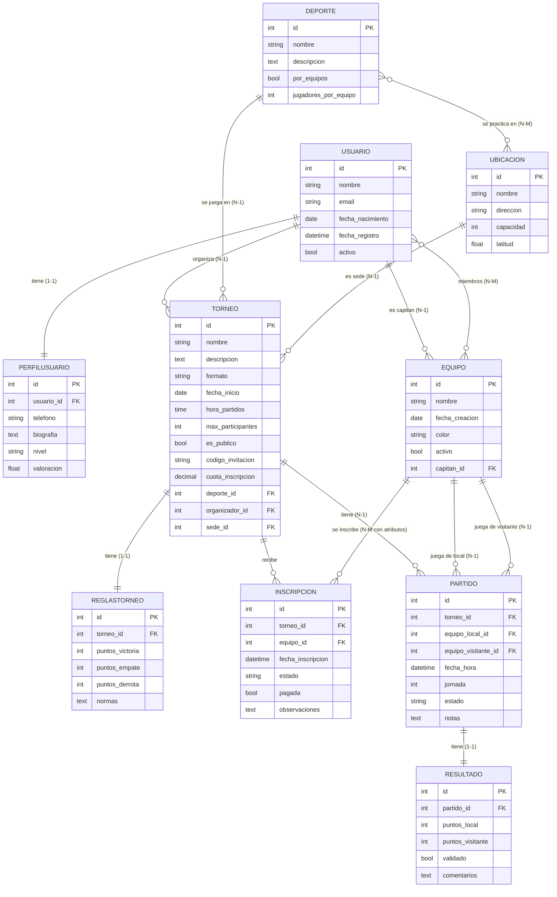

# TorneoHub

**TorneoHub** es una aplicación web hecha con Django que permite crear torneos deportivos y apuntarse a otros, tanto públicos como privados (por invitación). Permite buscar torneos por deporte, fecha, nivel y ubicación, inscribirse por equipos, generar calendarios, registrar resultados y consultar la clasificación.

El rol depende del torneo: quien lo crea es su administrador y los inscritos son participantes.

**Autor:** Guillermo Peláez y Pedro Rivas · 2º DAW · IES Polígono Sur

---

## Cómo ejecutarlo

```bash
git clone https://github.com/TU_USUARIO/torneohub.git
cd torneohub
python3 -m venv venv
source venv/bin/activate        # En Windows: venv\Scripts\activate
pip install -r requirements.txt
python manage.py migrate
python manage.py createsuperuser
python manage.py runserver
```

## Ramas del repositorio

| Rama | Contenido |
|---|---|
| `Configuracion_inicial` | Proyecto Django y configuración |
| `Modelos` | Modelos, README, esquema E-R y seeders |
| `Backups` | Fixtures con copias de los datos |

---

## Esquema entidad-relación



### Resumen de relaciones

| Tipo | Relación |
|---|---|
| OneToOne | `PerfilUsuario` ↔ `Usuario` |
| OneToOne | `ReglasTorneo` ↔ `Torneo` |
| OneToOne | `Resultado` ↔ `Partido` |
| ManyToOne | `Equipo` → `Usuario` (capitán) |
| ManyToOne | `Torneo` → `Deporte`, `Usuario` (organizador), `Ubicacion` (sede) |
| ManyToOne | `Partido` → `Torneo`, `Equipo` (local), `Equipo` (visitante) |
| ManyToMany | `Ubicacion` ↔ `Deporte` (tabla intermedia automática) |
| ManyToMany | `Equipo` ↔ `Usuario` (miembros; tabla intermedia automática) |
| ManyToMany | `Torneo` ↔ `Equipo` a través de `Inscripcion` (tabla intermedia con atributos extra) |

---

## Modelos

### 1. Deporte
Deporte que se puede jugar en un torneo (fútbol, pádel, baloncesto...).

| Atributo | Tipo | Parámetros | Qué guarda |
|---|---|---|---|
| nombre | CharField | `max_length=50`, `unique=True` | Nombre del deporte, sin repetirse |
| descripcion | TextField | `blank=True` | Descripción opcional |
| por_equipos | BooleanField | `default=True` | Si se juega por equipos o individualmente |
| jugadores_por_equipo | IntegerField | `default=5` | Número de jugadores de cada equipo |

### 2. Ubicacion
Lugar donde se celebran los torneos (pabellón, polideportivo, campo...).

| Atributo | Tipo | Parámetros | Qué guarda |
|---|---|---|---|
| nombre | CharField | `max_length=100` | Nombre del lugar |
| direccion | CharField | `max_length=200` | Dirección |
| capacidad | IntegerField | `null=True`, `blank=True` | Aforo (opcional) |
| latitud | FloatField | `null=True`, `blank=True` | Coordenada geográfica (opcional) |
| deportes | ManyToManyField | `related_name='ubicaciones'` | Deportes que se pueden practicar allí |

### 3. Usuario
Persona registrada en la aplicación.

| Atributo | Tipo | Parámetros | Qué guarda |
|---|---|---|---|
| nombre | CharField | `max_length=80` | Nombre del usuario |
| email | EmailField | `unique=True` | Correo electrónico, sin repetirse |
| fecha_nacimiento | DateField | `null=True`, `blank=True` | Fecha de nacimiento (opcional) |
| fecha_registro | DateTimeField | `auto_now_add=True` | Fecha y hora en que se registró (automática) |
| activo | BooleanField | `default=True` | Si la cuenta está activa |

### 4. PerfilUsuario
Datos adicionales de cada usuario (relación uno a uno).

| Atributo | Tipo | Parámetros | Qué guarda |
|---|---|---|---|
| usuario | OneToOneField | `on_delete=models.CASCADE` | Usuario al que pertenece el perfil |
| telefono | CharField | `max_length=15`, `blank=True` | Teléfono (opcional) |
| biografia | TextField | `blank=True` | Texto de presentación |
| nivel | CharField | `max_length=20`, `choices=NIVELES`, `default='aficionado'` | Nivel de juego: aficionado, intermedio o competitivo |
| valoracion | FloatField | `default=0` | Valoración media del jugador |

### 5. Equipo
Equipo de jugadores que se inscribe en los torneos.

| Atributo | Tipo | Parámetros | Qué guarda |
|---|---|---|---|
| nombre | CharField | `max_length=60` | Nombre del equipo |
| fecha_creacion | DateField | — | Fecha en que se creó el equipo |
| color | CharField | `max_length=20`, `blank=True` | Color de la equipación (opcional) |
| activo | BooleanField | `default=True` | Si el equipo sigue activo |
| capitan | ForeignKey | `on_delete=models.CASCADE`, `related_name='equipos_capitaneados'` | Usuario que es capitán |
| miembros | ManyToManyField | `related_name='equipos'` | Usuarios que forman el equipo |

### 6. Torneo
Competición deportiva, pública o privada.

| Atributo | Tipo | Parámetros | Qué guarda |
|---|---|---|---|
| nombre | CharField | `max_length=100` | Nombre del torneo |
| descripcion | TextField | `blank=True` | Descripción |
| formato | CharField | `max_length=20`, `choices=FORMATOS`, `default='liga'` | Liga o eliminatoria |
| fecha_inicio | DateField | — | Día en que empieza |
| hora_partidos | TimeField | `null=True`, `blank=True` | Hora habitual de los partidos |
| max_participantes | IntegerField | `default=8` | Número máximo de equipos |
| es_publico | BooleanField | `default=True` | Público (visible para todos) o privado |
| codigo_invitacion | CharField | `max_length=10`, `unique=True`, `null=True`, `blank=True` | Código para entrar a un torneo privado |
| cuota_inscripcion | DecimalField | `max_digits=6`, `decimal_places=2`, `default=0` | Precio de inscripción en euros |
| deporte | ForeignKey | `on_delete=models.CASCADE` | Deporte del torneo |
| organizador | ForeignKey | `on_delete=models.CASCADE`, `related_name='torneos_organizados'` | Usuario administrador del torneo |
| sede | ForeignKey | `on_delete=models.CASCADE`, `related_name='torneos'` | Ubicación donde se juega |
| equipos | ManyToManyField | `through='Inscripcion'` | Equipos inscritos (a través de `Inscripcion`) |

### 7. ReglasTorneo
Reglas de puntuación de cada torneo (relación uno a uno).

| Atributo | Tipo | Parámetros | Qué guarda |
|---|---|---|---|
| torneo | OneToOneField | `on_delete=models.CASCADE` | Torneo al que pertenecen las reglas |
| puntos_victoria | IntegerField | `default=3` | Puntos por ganar |
| puntos_empate | IntegerField | `default=1` | Puntos por empatar |
| puntos_derrota | IntegerField | `default=0` | Puntos por perder |
| normas | TextField | `blank=True` | Normas en texto libre |

### 8. Inscripcion
Tabla intermedia entre `Torneo` y `Equipo`, con atributos extra.

| Atributo | Tipo | Parámetros | Qué guarda |
|---|---|---|---|
| torneo | ForeignKey | `on_delete=models.CASCADE` | Torneo en el que se inscribe |
| equipo | ForeignKey | `on_delete=models.CASCADE` | Equipo que se inscribe |
| fecha_inscripcion | DateTimeField | `auto_now_add=True` | Fecha y hora de la inscripción (automática) |
| estado | CharField | `max_length=20`, `choices=ESTADOS`, `default='pendiente'` | Pendiente, aceptada o rechazada |
| pagada | BooleanField | `default=False` | Si se ha pagado la cuota |
| observaciones | TextField | `blank=True` | Comentarios del organizador |

### 9. Partido
Encuentro entre dos equipos dentro de un torneo.

| Atributo | Tipo | Parámetros | Qué guarda |
|---|---|---|---|
| torneo | ForeignKey | `on_delete=models.CASCADE` | Torneo al que pertenece |
| equipo_local | ForeignKey | `on_delete=models.CASCADE`, `related_name='partidos_local'` | Equipo local |
| equipo_visitante | ForeignKey | `on_delete=models.CASCADE`, `related_name='partidos_visitante'` | Equipo visitante |
| fecha_hora | DateTimeField | — | Fecha y hora del partido |
| jornada | IntegerField | `default=1` | Número de jornada o ronda |
| estado | CharField | `max_length=20`, `choices=ESTADOS`, `default='programado'` | Programado, jugado o suspendido |
| notas | TextField | `blank=True` | Notas adicionales |

### 10. Resultado
Marcador de un partido (relación uno a uno).

| Atributo | Tipo | Parámetros | Qué guarda |
|---|---|---|---|
| partido | OneToOneField | `on_delete=models.CASCADE` | Partido al que pertenece |
| puntos_local | IntegerField | `default=0` | Puntos del equipo local |
| puntos_visitante | IntegerField | `default=0` | Puntos del equipo visitante |
| validado | BooleanField | `default=False` | Si el administrador ha validado el resultado |
| comentarios | TextField | `blank=True` | Comentarios del resultado |

---

## Tipos de campo usados (sin contar relaciones)

| Tipo | Para qué sirve | Ejemplo |
|---|---|---|
| CharField | Texto corto con longitud máxima | `Deporte.nombre` |
| TextField | Texto largo | `Torneo.descripcion` |
| IntegerField | Número entero | `Torneo.max_participantes` |
| FloatField | Número decimal (coma flotante) | `PerfilUsuario.valoracion` |
| BooleanField | Verdadero o falso | `Usuario.activo` |
| DateField | Fecha | `Torneo.fecha_inicio` |
| DateTimeField | Fecha y hora | `Partido.fecha_hora` |
| TimeField | Hora | `Torneo.hora_partidos` |
| DecimalField | Número decimal exacto (dinero) | `Torneo.cuota_inscripcion` |
| EmailField | Texto que valida el formato de un email | `Usuario.email` |

## Parámetros usados

| Parámetro | Para qué sirve | Dónde se usa |
|---|---|---|
| `max_length` | Longitud máxima de un campo de texto | `Deporte.nombre`, `Usuario.nombre`... |
| `unique` | El valor no se puede repetir en la tabla | `Deporte.nombre`, `Usuario.email`, `Torneo.codigo_invitacion` |
| `null` | Permite guardar `NULL` en la base de datos | `Ubicacion.capacidad`, `Usuario.fecha_nacimiento` |
| `blank` | Permite dejar el campo vacío en formularios y en el admin | `Deporte.descripcion`, `PerfilUsuario.telefono` |
| `default` | Valor por defecto si no se indica ninguno | `Deporte.por_equipos`, `Torneo.max_participantes` |
| `choices` | Limita el valor a una lista de opciones | `PerfilUsuario.nivel`, `Torneo.formato`, `Inscripcion.estado` |
| `auto_now_add` | Guarda automáticamente la fecha y hora al crear el registro | `Usuario.fecha_registro`, `Inscripcion.fecha_inscripcion` |
| `max_digits` | Número total de dígitos de un `DecimalField` | `Torneo.cuota_inscripcion` |
| `decimal_places` | Número de decimales de un `DecimalField` | `Torneo.cuota_inscripcion` |
| `on_delete` | Qué hacer al borrar el registro relacionado (`CASCADE` borra también los dependientes) | Todas las `ForeignKey` y `OneToOneField` |
| `related_name` | Nombre de la relación inversa; evita conflictos entre relaciones al mismo modelo | `Equipo.capitan`, `Partido.equipo_local`... |
| `through` | Indica la tabla intermedia propia de una relación muchos a muchos | `Torneo.equipos` → `Inscripcion` |

---

## Datos de prueba

Generar 10 registros aleatorios de cada modelo con Faker:

```bash
python manage.py generar_datos
```

Crear una copia de los datos (fixture):

```bash
python manage.py dumpdata torneos --indent 4 > torneos/fixtures/datos.json
```

Restaurar los datos en una base de datos nueva:

```bash
python manage.py migrate
python manage.py loaddata torneos/fixtures/datos.json
```

---

## Código no visto en clase

| Código | Explicación |
|---|---|
| `DecimalField(max_digits=6, decimal_places=2)` | Campo para números decimales exactos, como el dinero. `max_digits` es el total de dígitos y `decimal_places` cuántos son decimales. Con 6 y 2 se admiten valores hasta 9999.99 |
| `EmailField` | Igual que un `CharField`, pero comprueba que el texto tenga formato de correo electrónico |
| `auto_now_add=True` | Django rellena el campo con la fecha y hora actuales solo al crear el registro, y no se puede modificar después |
| `NIVELES = [('aficionado', 'Aficionado'), ...]` | Lista de tuplas para `choices`. El primer valor es el que se guarda en la base de datos y el segundo el que se muestra al usuario |
| `f"Perfil de {self.usuario.nombre}"` | Cadena con formato (f-string): lo que va entre llaves se sustituye por el valor de la variable |
| `admin.site.register([...])` | Registra varios modelos de una vez en el panel de administración pasando una lista |

(Añadir aquí el código de `generar_datos.py` que no se haya visto en clase, por ejemplo los métodos de Faker que se usen.)